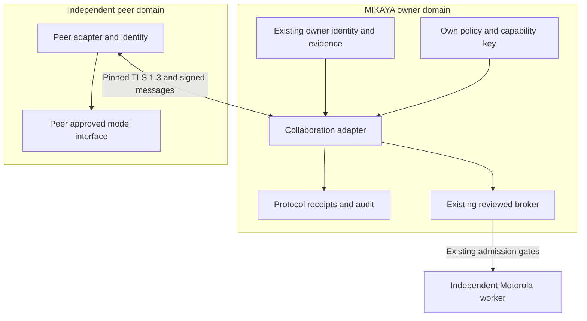

# MIKAYA × ACT-Omega collaboration interface

This directory contains an executable collaboration port around the existing independent-node federation. It implements authenticated HTTP/2 and HTTP/1.1 over TLS 1.3, pinned peer keys, attenuating capability tokens, durable transaction receipts, security telemetry and resumable signed **public/Toybox** artifact transfer. Each side keeps its own identity, policy, issuer secret, journal and shutdown authority.

The code is an unpaid bounded collaboration profile. An ACT model endpoint is not invented by this package. ACT compute continues through the original reviewed broker, reviewer report, owner grant and independent worker. The generic model-specific request/response adapter, bilateral ACT enrollment and hardware admission remain separate acceptance work.

## Run it now

Requirements: Node 22 or newer and OpenSSL for the isolated demo's temporary certificates. The executed runtime versions and exact test results are recorded in `ACCEPTANCE.md`; a version floor is not a claim that every version was executed.

From this repository root, using a **new absolute directory**:

```sh
node engineering/federation/collaboration/gateway-adapter.cjs demo \
  --directory /absolute/private/path/collaboration-lab
```

The command creates two independent software identities in that new directory, generates lab certificates, opens a loopback mTLS listener, exchanges signed requests, tests replay/conflict/token rejection, transfers and resumes a signed 131,109-byte public artifact, runs 30 paired HTTP/2 versus persistent HTTP/1.1 screening samples, writes `acceptance-report.json`, and stops its listener. It does not use or alter an existing phone identity or evidence ledger. Lab keys stay in the private lab directory; they are not ACT enrollment credentials.

For the actual Android installation and return after a new Termux shell, follow [OPERATIONS.md](OPERATIONS.md). The installed command verifies the source manifest on every invocation.

```sh
mikaya-collaboration preflight
mikaya-collaboration status --directory /absolute/private/path/collaboration-lab/gateway-a
```

`status` reports configuration and writer-lease presence; a lease alone cannot distinguish a running service from crash uncertainty. `serve` runs in the foreground until Ctrl-C. There is no automatic boot activation or stale-state deletion.

## Trust boundaries



The collaboration journal records this protocol's acceptance and response digests; it is not a replacement for the existing signed sovereign evidence ledger. `127.0.0.1:4188` remains owner-local. This release does not export its raw evidence or private AHAVA mesh key. The new adapter never calls an arbitrary URL supplied in a request.

## Wire contract

Business operations use `POST /v1/collaboration`, content type `application/json`, and exact canonical JSON. Controls are at most 8,192 bytes including the capability and signature. Binary chunk responses are separate bounded bodies of at most 65,536 bytes, with an independently signed response header. Other responses have a 32-KiB cap.

The stable intent contains schema, transaction ID, sender, recipient, operation, exact resource, payload SHA-256, policy version and fixed expiry. The outer attempt contains a fresh nonce/time, intent digest, capability digest, method and route, signed with the sender's original federation Ed25519 identity. A retry keeps the original intent and payload but generates a new attempt nonce/signature. A changed intent under the same sender/operation/transaction ID is a conflict.

| Operation | Resource semantics | Result |
| --- | --- | --- |
| `collaboration.describe.v1` | Exactly `collaboration:self` | Bounded interface metadata; no automatic admission |
| `toybox.transaction.v1` | Exactly `toybox:transactions` | Durable statement/artifact-digest receipt; no blockchain or payment verification claim |
| `receipt.read.v1` | Exactly `receipt:transactions` | Reads only the authenticated sender's receipt; the capability covers that sender's receipt collection |
| `artifact.metadata.verify.v1` | `manifest:<canonical AHAVA manifest SHA-256>` | Verifies enrolled publisher, existing AHAVA signature and separately signed monotonic release metadata; no fetch or activation |
| `artifact.manifest.read.v1` | `manifest:<public manifest SHA-256>` | Reads a locally published, explicitly configured signed public manifest |
| `artifact.chunk.read.v1` | `manifest:<SHA-256>:chunk:<index>` | Transfers exact verified public bytes with a signed digest receipt |
| `federation.broker.v1` | Exactly `broker:limitedcompute` | Forwards the unchanged original signed envelope to the existing configured loopback broker, which retains all admission checks |

There are no remote grant-issuance, policy-edit, shell, package-install, firmware, wallet or activation operations. Public distribution and private AHAVA transport are explicitly different profiles. See [DISTRIBUTION.md](DISTRIBUTION.md) and [CAPABILITY.md](CAPABILITY.md).

### Peer clock handshake

`POST /v1/session` accepts a canonical challenge signed by the enrolled federation identity over the same pinned mutual TLS connection. Its signed reply binds the fresh 128-bit nonce, both identities, challenge digest, policy version and responder time. It issues no token and has no business effect. Replay protection, current peer policy and the normal request/concurrency/body limits apply.

Use `await client.prepareRequest(options)` or the installed `request` command. The client accepts a clock sample only when its monotonic round trip is at most two seconds, caches it for at most 30 seconds, and refreshes with seven seconds of response headroom. Outgoing attempt times and response freshness checks use that peer's time estimate. Each owner still evaluates token and intent expiry on its own clock; the existing five-second future and 60-second past guards remain unchanged. Local OS time, existing federation admission and hardware evidence clocks are untouched. Excessive latency, a monotonic jump, stale calibration or a sudden peer clock change fails closed. Raw `client.send(envelope)` does not alter or re-sign an existing envelope; low-level callers must prepare it correctly.

The API retains `signedResponse` for independent receipt verification. A clock signature proves the enrolled peer answered this challenge; it does not establish civil-time accuracy, hardware attestation or authority to execute work.

### Authentication and authorization order

1. Validate TLS 1.3 certificate chain and pin the enrolled SPKI SHA-256. HTTP/1.1 and HTTP/2 apply the same handler and limits. The client pins the server before writing its capability or payload.
2. Reload current local policy after receiving the bounded body. Resolve the same independently pinned federation identity and verify the signed attempt, recipient, canonical body digest, nonce and time.
3. Verify the project-specific macaroon-style profile, current issuer epoch/policy version, authenticated TLS key binding, exact operation/resource, byte budget and concurrency ceiling. Tokens alone grant nothing.
4. Persist replay protection and a redacted audit event. Atomically reserve the stable root-grant usage budget and durable intent. All attenuated descendants share that root budget.
5. Return an existing receipt for a valid fresh retry before consuming another use. Recheck current enrollment, token and operation/resource immediately before an effect and before completing its receipt.
6. Sign response metadata and content digest. The client checks recipient, original attempt nonce, intent digest, response signature, result digest and current server enrollment.

The gateway accepts a maximum of eight concurrent requests overall, at most four configured per peer, 16 TCP connections, four advertised HTTP/2 streams per session, a five-second body deadline and a seven-second client deadline. Limits are enforced again by the capabilities. No 0-RTT application data is admitted. There is no automatic transport downgrade after an authentication failure; select HTTP/1.1 explicitly if the peer supports that contract.

## Connect an existing owner-controlled node

Prepare TLS credentials and a reviewed configuration outside the checkout. Each side provisions its own TLS private key and capability root; exchange only public certificates/CA material, exact SPKI digests and original federation public-key fingerprints through an authenticated channel. The required existing federation pin must already be present. `init` does not add or replace one.

The configuration schema is `mikaya.act.gateway-config.v1`. `demo.cjs` generates a complete valid configuration for reference; adapt it with actual independently verified values. Required fields are:

| Field | Required value |
| --- | --- |
| `mode` | `production` for the real adapter; `lab` only for an isolated fixture |
| `federationDirectory` | Existing absolute owner-node directory; never copied to the peer |
| `listen` | Explicit loopback, RFC1918, private IPv6 or approved CGNAT overlay address, plus unoccupied port 1024–65535; wildcard/public/DNS binds are rejected |
| `tls` | Absolute `certificate`, owner-private `privateKey`, and `caBundle` files; key must match certificate |
| `policyVersion`, `issuerEpoch`, `enabled` | `collaboration-v1`, nonnegative integer epoch, boolean independent kill switch |
| `peers` | Map of original federation fingerprint to `enabled`, `tlsBinding` (`sha256:<SPKI-DER digest>`), exact `operations`, exact `resources`, `maxUses` (1–2048), `maxConcurrent` (1–4) |
| `brokerUrl` | `null` initially, or an explicitly configured existing loopback HTTP broker origin with a distinct port |
| `artifacts` | Explicit array of public `manifestPath`, private source-file `sourcePath`, and `manifestDigest`; empty initially |

Use private 0700 directories and 0600 owner files. Cert/public trust files must be owner-held and not group/world writable. Paths must be canonical, nonsymlink paths. The adapter checks them again during requests. The real gateway and downstream worker retain their existing physical separation.

```sh
mikaya-collaboration init --directory /absolute/private/collaboration-state \
  --config /absolute/private/reviewed-config.json
mikaya-collaboration status --directory /absolute/private/collaboration-state
mikaya-collaboration serve --directory /absolute/private/collaboration-state
```

Issuance is a local CLI action by the resource owner. Limit lifetime to at most 120 seconds. A grant file is created with 0600 permissions and never printed:

```sh
mikaya-collaboration grant --directory /absolute/private/collaboration-state \
  --peer VERIFIED_PEER_FINGERPRINT \
  --scopes collaboration.describe.v1 --resources collaboration:self \
  --uses 1 --ttl-ms 60000 --output /absolute/private/new-description.cap
```

Deliver that short-lived capability only to the enrolled TLS key holder. A request descriptor has exactly `peer`, `url`, `capabilityFile`, `operation`, `resource`, `payload`, `transactionId`, `expiresAtMs`. The intent expiry cannot outlive the capability; a retry retains the original expiry. Use a new transaction ID for a separate action. Examples and commands are in the operations guide.

## Failure and recovery

Failed validation has no business effect. If an effect may have occurred after acceptance, the recorded state is `uncertain`, and the gateway will not blindly execute it again. Crash-held writer leases, missing initialized state, filesystem replacement, corruption, clock rollback, quota exhaustion and full journals remain HOLD conditions. They are never fixed by deleting files automatically.

The protocol journal and artifact policy each cap records at 2,048; runtime telemetry caps events at 2,048 and live nonces at 4,096. This is a deliberate bounded engineering release, not an unattended infinite-retention service. Export/rotation requires a separately reviewed checkpoint-preserving maintenance procedure. A full audit store stops further acceptance. Changing the issuer epoch revokes existing capabilities at the next operation; a reusable TLS session does not bypass that check.

The public distribution receiver keeps verified chunks and the monotonic publisher/artifact sequence across reconnects. It rehashes every reused file, checks the full object before `contentVerified:true`, and never executes it. Corrupt/partial cache bytes remain a reviewable HOLD. A transfer interruption does not renew the immutable manifest expiry.

## Tests and GitHub integration

```sh
node --test engineering/federation/collaboration/tests/*.cjs
python3 engineering/federation/collaboration/fixtures/capability_oracle.py
node --test engineering/federation/live/tests/*.cjs \
  engineering/federation/live/evidence-brief/tests/*.cjs \
  engineering/federation/mobile-edge/tests/*.cjs tests/test_ahava_resume.cjs
node --test integrations/security-tollbooth/verified-events/tests/*.cjs
node engineering/federation/collaboration/build-source-manifest.cjs
```

The source-manifest generator covers this collaboration package, its tests/fixtures/documentation, and its three transitive legacy files (`federation-node.cjs`, `security-tollbooth.cjs`, `ahava/core.js`). The original federation regression suites run from the full repository checkout. The manifest excludes its output and generated acceptance/evidence reports to avoid a circular evidence hash; it includes its own generator source. Pin the independently recorded manifest SHA-256 when installing. It is an integrity manifest, not a claim of a signed release authority.

This change is stacked on PR 10's reviewed source commit `1da7fbdd79e63f857b07af0738278156c19a9966`. Keep its branch intact. The collaboration PR targets `review/mobile-edge-gateway-hardening-20261118` until that prerequisite merges. Local tests avoid GitLab CI usage. Publication of a branch does not mean deployment, merging, hardware admission or ACT acceptance.

## Remaining bilateral acceptance

The implemented interface is usable for authenticated bounded collaboration and public artifact delivery. To claim an ACT model connection, retain an ACT operator-confirmed endpoint, adapter version, federation public key, TLS SPKI/CA, approved operation/resource limits and independent hardware evidence where required; execute a real model-specific task; verify its signed result; test revocation and disconnect; and record both owners' acceptance. An installed ACT source repository or an open port alone does not provide those inputs. Private encrypted artifact key agreement, the Android companion lifecycle service, hardware-backed key attestation, long-duration network/Doze/reboot acceptance and HTTP/3 remain separate work items.
