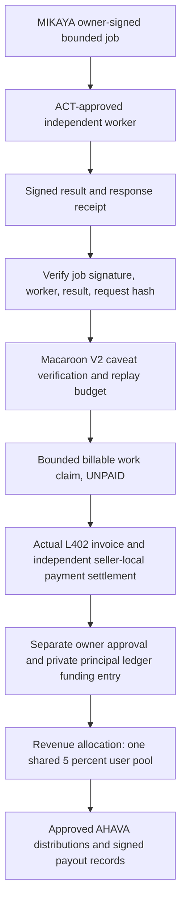

# MIKAYA × ACT-Omega: signed work receipt → revenue → AHAVA

## Architecture boundary (2026-11-21)

A completed federated computation produces a **signed evidence receipt**, not newly minted money. That receipt can support a **billable work claim**. Only an actual customer payment, independently checked through the seller's own settled invoice and the owner's accounting policy, can become new service revenue. AHAVA's user dividend is **one shared 5% pool of newly verified revenue**, divided among separately approved physical participants under the existing private ledger's equal-share policy. It is *not* 5% paid separately to every device.



**Today's tested boundary is the signature-and-caveat claim and the read-only seller/owner handoff calculation.** There is no actual ACT worker in this test, no current L402 settlement, no new money in the private principal ledger and no AHAVA transfer.

## Common-ground protocol

Two independent intelligences need **shared semantics**, not shared internal code, private keys or autonomous ownership. The external ACT operator can implement the following optional adapter without modifying its own intelligence kernel:

| Layer | Existing MIKAYA contract | ACT compatibility requirement | Status |
|---|---|---|---|
| Identity | Separate Ed25519 root/key fingerprints, signed join invite and reply, pinned TLS peer | ACT-controlled verified public identity and separately authorized transport | **Not admitted** |
| Job | `mikaya.federation.request.v1` + `mikaya.federation.job.v1` | Translate explicitly approved ACT worker capability into a bounded signed request | Source contract only |
| Caveat | Macaroon V2, first-party chained HMAC caveats, holder/audience/profile/body/operation/nonce/expiry/use/byte limits | ACT adapter must parse/verify the agreed profile; no silent widening or unknown third-party caveats | Local **isolated-test** conformance |
| Work receipt | Signed `mikaya.federation.response.v1` and deterministic result, bound to job ID and request digest | ACT independently signs its result with its **own** key | Tested with synthetic LAB-PEER, **not ACT** |
| Billing | Seller-signed `mikaya.federation.service-quote.v1` | Actual seller invoice priced in BTC-LN-msat, no double billing of reciprocal jobs | Source verified |
| Settlement | Private standard-L402 helper, actual seller-local LND settlement verification | Buyer/seller approval, paid Lightning invoice proof and replay controls | No live settlement in this change |
| Revenue | Private owner-signed SQLite journal, `funding.register` `SERVICE_REVENUE` | Independently checked seller evidence and owner approval before any journal mutation | Handoff reference only |
| AHAVA pool | Shared 500 basis points on new verified revenue; private participant eligibility | One common pool, not a fresh 5% per node; separate financial / legal approval | Preview arithmetic only |
| Toybox | Historical read-only Bitcoin mainnet proof | Optional independent chain observation, **not** revenue proof | Historical observation only |

ACT's public Python client exposes general API endpoints; the inspected public source **does not prove that it implements or accepts MIKAYA's Macaroon V2 profile, signed job schema or live billing**. Therefore, this source change never registers ACT as a peer or contacts its endpoints.

## Public source implementation

- `engineering/federation/interop/capability-macaroons.cjs` is the existing reviewed Macaroon V2 first-party-conformance implementation, brought into independent `main` review with its original upstream test vectors and BSD-3-Clause license.
- `engineering/federation/live/work-revenue-bridge.cjs` validates the original signed two-party proof and seller quote, selects **exactly the job performed by the billed seller for the buyer**, and consumes a matching single-use Macaroon capability scoped to the original signed request body and nonce.
- `prepareWorkClaim` returns a frozen *unpaid* claim containing SHA-256 links to the signed proof, signed job, signed quote and original macaroon bytes. It never returns secret keys or a bearer token and does not issue a live grant.
- `reconcileSettlement` requires separately configured seller-settlement and owner-review functions. Their results must match the claim, work proof, quote, canonical msat amount, invoice payment hash, settlement ID, and fee/net revenue conservation. It returns **a reconciliation handoff, not a funds deposit**.
- The old private accounting model operates in **BTC-sat** while Lightning billing uses **BTC-LN-msat**. The handoff refuses non-integral sat conversion rather than truncating or silently redistributing fractional funds.
- The shared user-pool preview uses floor(net revenue sat × 500 / 10,000). The remainder is kept *outside* this pool; it does **not** override or silently distribute the existing family/architect/carry allocations.

The in-process claim is protected from forged JSON objects with an internal identity membership check, but that does not provide persistent entitlement across restarts. A production gateway must create an independently verifiable owner-signed, durable claim before allowing it into the **existing** private ledger. The latter already has its own idempotent settlement ID and signed journal semantics.

## Release acceptance gates

1. Keep the reviewed MIKAYA source and true ACT worker builds independent. Obtain ACT operator-signed protocol acceptance and key fingerprint out of band.
2. Run signed, pinned, bounded two-way operations with owner-approved Macaroon caveats **before** execution. This offline billing test checks the same caveat context after the fact and **does not constitute production admission**.
3. Capture fresh physical transport and worker execution receipts. An asserted hardware mode or third-party certificate string does not establish manufacturer hardware attestation.
4. Seller-local L402 checks must independently validate a **new** invoice, settlement, price, scope and non-replayed payment. Never use a historical Bitcoin Toybox transaction as a new service payment.
5. The private principal ledger must independently register new settled `SERVICE_REVENUE` using its own configured seller verifier and owner approval, only once per settlement ID, before any dividend balance increases.
6. Reconcile the actual settled ledger basis, active owner-approved physical participants, principal separation, reserve conservation, legal classification, and settlement before a payout engine is permitted.
7. Bind the new journal event to the complete predecessor hash and a signed witness checkpoint. Preserve the existing per-entry key rotation and off-device high-water requirements.
8. Retain ACT's separate keys, workers, identity, data, finances and policy; **no code path** may implicitly enroll or charge ACT, grant shell/firmware authority or start call tracing.

## Testing

```bash
node --test engineering/federation/interop/tests/test_capability_macaroons.cjs
node --test engineering/federation/live/tests/test_work_revenue_bridge.cjs
```

The tests use disposable local node identities and mock seller-local verifier callbacks. They do not transmit data to ACT, invoke any wallet or create external financial records. The work claim and settlement handoff are testable today; actual revenue remains contingent on an independently performed real sale.

## Trust classification

- Signed task/result: `SIGNED_WORK_PROVEN`
- Macaroon V2 in current source: `ISOLATED_TEST_CAVEATS_VERIFIED`
- Signed, seller-scoped claim: `BILLABLE_CLAIM_UNPAID`
- Reconciled configured seller-verifier response: `SETTLEMENT_EVIDENCE_READY_FOR_PRIVATE_LEDGER_REVIEW` **not credited**
- Private signed journal funding: **not executed**
- AHAVA shared pool allocation and payout: **not executed**
- ACT bilateral physical deployment and acceptance: **not completed**

Retain source, historical evidence, seller payment evidence and actual authorization as separate provenance classes.
